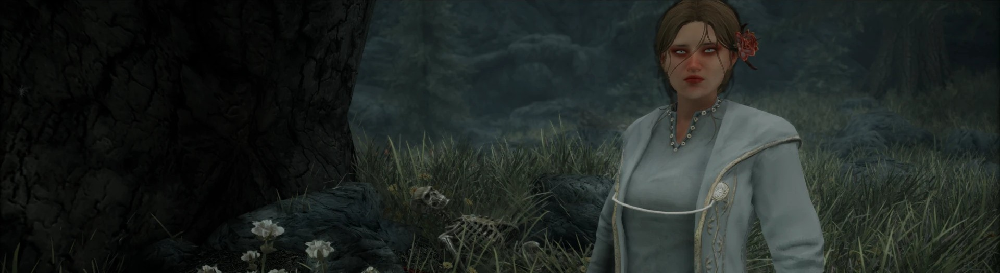
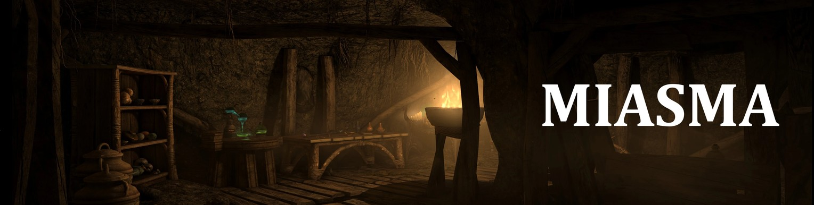
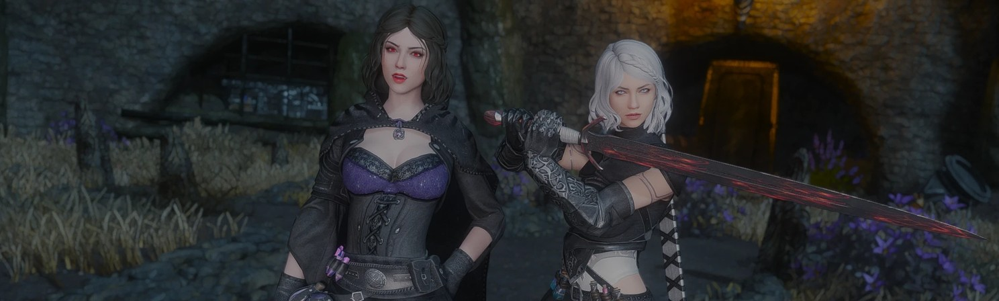
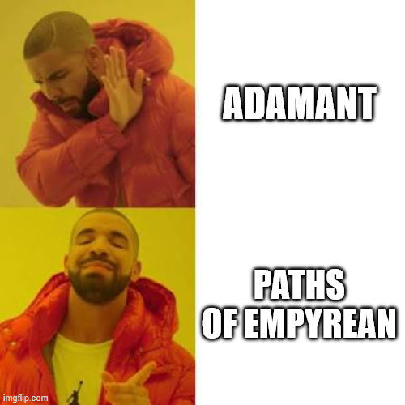
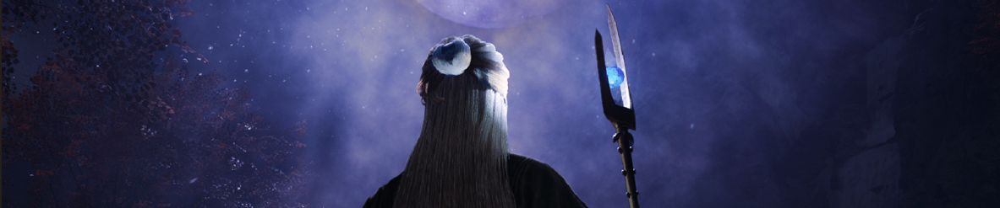
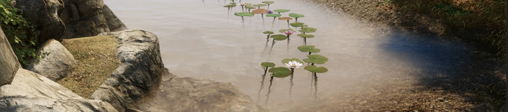

# Lumina 0.4
version: 0.4
date: 2026-10-24
cover: 0.4/cover.png
banner: ../media/24.jpg
summary: A big clean-up, VIGILANT and Miasma, a lot more Serana, and a brand new perk system with Paths of Empyrean.

## Clean Up

0.4 is a big one, and a lot of that comes from cleaning house.

I went through the whole list and pulled anything that was buggy, outdated, or just sitting there while another mod already did the job better.

- Dirt and Blood made way for Bathing in Skyrim
- Reticle Arcs swallowed the casting bar and the oxygen meter
- A bunch of small fixes now live right inside Community Shaders

A few favorites had to go too, like Anga's Mill. If I find the time to patch it myself, it'll be back.

While I was in there, I fixed **over 400 NPC records** and 100+ conflicts, patched up broken navmesh and seams along the northern roads, cleared the black water out of Dawnstar's Temple of Dibella, and sorted a darkface bug some drivers were hitting. Innkeepers will finally refill your waterskins, and general stores now sell camping supplies.

## New Content

### VIGILANT

**VIGILANT is finally in!** A full Daedric questline that takes you all the way to Coldharbour.

It's late-game content, so it won't show up until you're **level 40** and have finished The House of Horrors, Kindred Judgment and Dragonslayer.

What I changed for Lumina:
- Weapons list their abilities right in the description, with their own icons
- Stats, costs and loot rebalanced
- Unique gear can't be custom-enchanted
- Vampires turn to ash like they should
- Stormcloaks stop attacking you for wearing the armor

### Miasma

[Miasma](https://www.nexusmods.com/skyrimspecialedition/mods/149879) is a fully voiced quest in the Ashlands of Solstheim. You team up with Haj-Xul, an Argonian from Black Marsh, to hunt down a rogue Telvanni wizard, with new dungeons, a unique bow and nine new spells along the way.

Talk to Haj-Xul in the Retching Netch in Raven Rock to start it. Aim for **level 20** or so, since it's about as tough as the rest of Dragonborn.

### Serana and Ashe

[Serana Dialogue Add-On](https://www.nexusmods.com/skyrimspecialedition/mods/32161) is in, and Serana has a LOT more to say now, with **over 8,000 voiced lines**.
- She comments on quests, places and even the weather
- She slowly opens up to you the longer you travel together
- Teach her spells, give her gifts, ride together, and have her cook for you
- And yes, there's a romance

Bring Ashe along too and they finally talk to each other. [Ashe and Serana banter](https://www.nexusmods.com/skyrimspecialedition/mods/167123) adds **over 1,000 lines** covering Dawnguard, Ashe's story, travel and combat. They argue, they bond, and it shifts depending on who you're romancing.

## Perks

All the old perks are gone. Bye bye, Adamant, you served us well.

Taking its place is [Paths of Empyrean](https://www.nexusmods.com/skyrimspecialedition/mods/58656), a roleplay-first overhaul of **all 18 skill trees**. Perks now open up new ways to play instead of adding another 5% damage: build your own Dwarven automatons, tame wild beasts and ride them into battle, raise a skeleton army, brew throwable bombs, or play instruments for gold. And that's just a taste, so go poke around the perk trees.

## Combat and Magic

Mysticism is gone, and magic in Lumina now runs fully on [Lost Grimoire SSE](https://www.nexusmods.com/skyrimspecialedition/mods/4455). That's **115+ new spells** across all five schools: turn into a fox or a wolf, swap places with your target, walk on water, summon new familiars and Dremora, and plenty more. Every spell also comes as a scroll and a staff, the tomes show up at vendors on their own, and it ties straight into the new Paths of Empyrean perk trees.

On top of that, [Natura](https://www.nexusmods.com/skyrimspecialedition/mods/77826) adds nature spells, [Winter Wonderland Magic](https://www.nexusmods.com/skyrimspecialedition/mods/93871) brings fancy frost spells, [Obscure Magic](https://www.nexusmods.com/skyrimspecialedition/mods/103805) throws in a dozen odd ones across the schools, and [Holy Templar Magic](https://www.nexusmods.com/skyrimspecialedition/mods/113360) finally gives Restoration some bite.

Combat got some love too. Spell absorption is no longer a dice roll: it always triggers and caps at **80%**. Casting and breath now show as arcs around your crosshair, NPCs dodge your attacks, there are new first-person dual-wield sword animations, and artifacts got a big rebalance.

## Transmog

[Fitting Room - ESO Style Transmog](https://www.nexusmods.com/skyrimspecialedition/mods/185342) lets you wear the look of any outfit while keeping the stats of your real gear. Save up to **20 outfits** for yourself and 20 more for every follower, and switch between them whenever you like. Stats, enchantments and weight never change.

It does a lot more than transmog, too. Dye your gear, hair and even eyes with over 450 dyes, set rules like taking your helmet off indoors or pulling your hood up in the rain, and play with skins, tattoos, scars and war paint on the fly.

Lumina uses the lore-friendly setup, so you'll need to buy The Seamstone from Farengar in Dragonsreach to use it. Dyes are earned too, by finishing questlines, earning achievements, and discovering or clearing locations.

## World and Atmosphere

Skyrim got a lot prettier this time around, and you'll notice it the moment you step off the road.

The flora is fully 3D now: lavender fields, glowing deathbell and mushrooms, nirnroot that actually lights up its surroundings, clover, jazbay, spiky grass, and water plants all along the riverbanks. The mountains have been redone in **PBR**, the standing stones got the same treatment, and dead trees finally stopped sprouting random mushrooms.

Places feel more lived in too. There are new alchemy and enchanting tables, fresh pottery, proper vampire clutter in their lairs, and Volkihar Castle has a brand new soundscape. Khajiit have real fur now thanks to dynamic fur shaders, and the Companions, hold guards and elves all got new or refreshed armor. Oh, and volcanic steam is dimmer at night, so it stops glowing like a lamp after dark.

## UI
The first thing you'll see in 0.4 is a **brand new main menu**, and right after it comes **Choose Your Experience**, where you decide how hard Skyrim gets to push back:

- Survival: hunger, fatigue and cold wear you down, and fast travel is off
- Stress and Fear: battle builds stress and some foes leave lasting fears, until a good meal, a strong drink or a night's rest calms you down
- Bathing: dirt and grime build up, so wash in rivers and lakes, and use soap for extra benefits
- Season: start on the usual date, or let it pick a random day of the year

Beyond that, RaceMenu got a big upgrade with more options and better stability, your inventory shows a lot more info at a glance, items finally have proper descriptions, and the map now supports CoMAP. The missives board will also tell you when it's still updating, instead of leaving you wondering if it's broken. Big shoutout to **Nithog** for fixing up my UI, including the shout meter on the compass.
